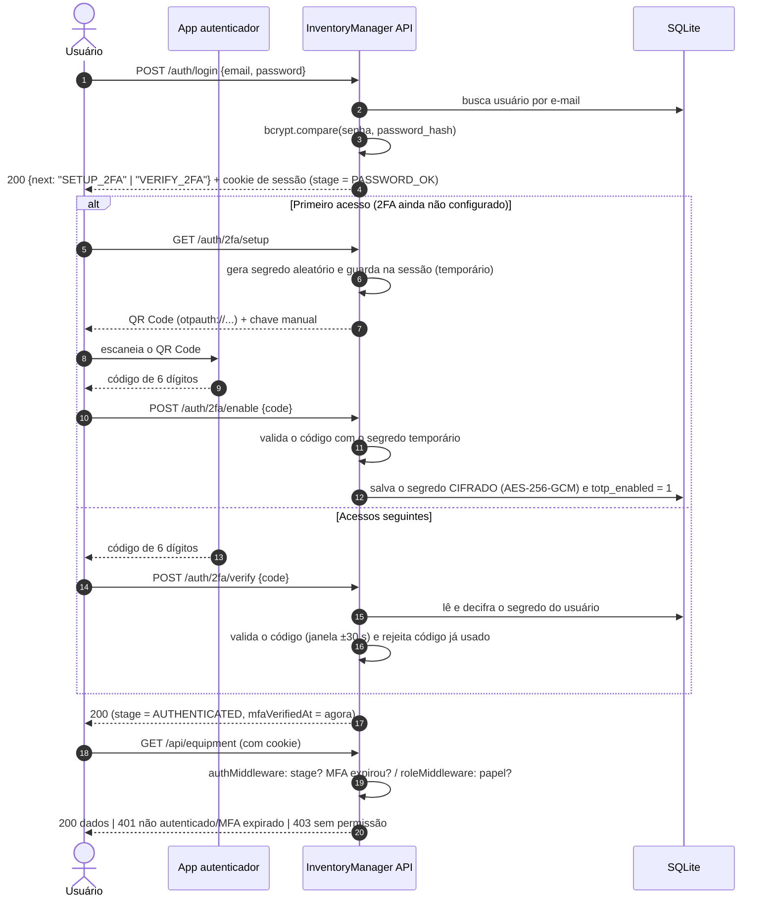

# InventoryManager — Empréstimo de Equipamentos de TI com 2FA (TOTP)

API REST para controlar o empréstimo de equipamentos de alto valor (notebooks, desktops, monitores…) de um departamento de TI. O acesso é exclusivo para **técnicos** e **administradores** e protegido por **autenticação em dois fatores com TOTP**: senha + código de 6 dígitos gerado por um app autenticador (Google Authenticator, Microsoft Authenticator, Authy…).

> Projeto da AV2 de **Técnicas de Integração de Sistemas**: Autenticação em Sistemas Integrados.

- **Versão no ar:** https://inventorymanager-pjpd.onrender.com
- **Plano do projeto:** [docs/PLAN.md](docs/PLAN.md)

---

## Sumário
1. [Sobre o sistema](#1-sobre-o-sistema)
2. [Autenticação: 2FA com TOTP](#2-autenticação-2fa-com-totp)
3. [Como rodar localmente](#3-como-rodar-localmente)
4. [Guia de uso](#4-guia-de-uso)
5. [Endpoints e exemplos de requisição](#5-endpoints-e-exemplos-de-requisição)
6. [Integração com APIs externas](#6-integração-com-apis-externas)
7. [Deploy](#7-deploy)
8. [Estrutura do projeto](#8-estrutura-do-projeto)
9. [Equipe](#9-equipe)

---

## 1. Sobre o sistema

### O que faz
O departamento de TI mantém um estoque de equipamentos caros que são emprestados a outros setores. O **InventoryManager** registra:
- quais equipamentos existem, quanto valem e onde estão;
- quem pegou cada equipamento, para qual setor e até quando deve devolver;
- quem tem acesso ao sistema.

### Por que 2FA?
Uma senha vazada daria a qualquer pessoa o poder de registrar a saída de um notebook de milhares de reais. Com o segundo fator, o atacante também precisaria do **celular físico** do técnico. Por isso o 2FA é **obrigatório para todas as contas**, inclusive a do administrador.

### Casos de uso
| # | Ator | Caso de uso |
|---|---|---|
| 1 | Admin | Criar a conta de um novo técnico (nome, e-mail, senha inicial, papel) |
| 2 | Admin | Editar, desativar ou excluir uma conta |
| 3 | Admin | Resetar o 2FA de um técnico que perdeu o celular |
| 4 | Todos | Primeiro acesso: login com senha → configurar o 2FA lendo o QR Code |
| 5 | Todos | Acessos seguintes: login com senha → código de 6 dígitos do app |
| 6 | Technician | Consultar o estoque (com o valor do equipamento convertido para reais) |
| 7 | Technician | Registrar o empréstimo de um equipamento (a devolução prevista pula feriados) |
| 8 | Technician | Registrar a devolução e consultar o histórico de empréstimos |

### Tipos de usuário e permissões
| Permissão | `admin` | `technician` |
|---|:---:|:---:|
| Login + 2FA obrigatório | ✅ | ✅ |
| Gerenciar contas (`/api/users`) | ✅ | ❌ 403 |
| Resetar 2FA de outro usuário | ✅ | ❌ 403 |
| Ver estoque (`/api/equipment`) | ❌ 403 | ✅ |
| Registrar empréstimo/devolução (`/api/loans`) | ❌ 403 | ✅ |

O admin **não** vê o estoque de propósito (princípio do menor privilégio): a função dele é só controlar quem tem acesso.

### Dados gerenciados
| Recurso | Campos |
|---|---|
| **users** | id, name, email, password_hash, role, totp_secret_enc, totp_enabled, last_totp_step, failed_attempts, locked_until, active, created_at |
| **equipment** | id, asset_tag, type, brand, model, serial_number, value_usd, status, location, created_at |
| **loans** | id, equipment_id, technician_id, borrower_name, destination_department, checkout_date, expected_return_date, returned_at, notes, status |

**Dados protegidos:** `password_hash` e `totp_secret_enc` nunca saem da API. O segredo TOTP fica **cifrado** no banco, e o histórico de empréstimos só é visível para usuários autenticados com 2FA.

---

## 2. Autenticação: 2FA com TOTP

### O que é TOTP
**TOTP (Time-based One-Time Password, RFC 6238)** gera um código numérico que muda a cada 30 segundos. Servidor e celular compartilham um **segredo** (combinado uma única vez pelo QR Code) e calculam o código de forma independente:

```
passo  = floor(horário_unix / 30)                 # muda a cada 30 s
hash   = HMAC-SHA1(segredo, passo)
código = truncar(hash) mod 10^6                   # 6 dígitos, ex.: 482913
```

Se os dois chegam ao mesmo número, o usuário prova que **tem o celular** onde o segredo foi cadastrado. A rede não é usada: o app funciona offline.

A autenticação combina dois fatores:
- **Algo que você sabe:** a senha (verificada com bcrypt).
- **Algo que você tem:** o celular com o app autenticador (verificado com TOTP).

### Como funciona, passo a passo

A sessão do usuário passa por **estágios** guardados no servidor:

```
(sem sessão) ──senha correta──► PASSWORD_OK ──código TOTP correto──► AUTHENTICATED
                                                                          │
                       sessão destruída ◄── logout ou MFA_TTL expirou ◄───┘
```



1. **Login com senha.** `POST /auth/login` compara a senha com o hash bcrypt. Se estiver certa, a API cria uma sessão no estágio `PASSWORD_OK` e devolve um cookie `httpOnly`. Nesse estágio o usuário **ainda não acessa nenhuma rota protegida**. A resposta diz o próximo passo: `SETUP_2FA` ou `VERIFY_2FA`.
2. **Primeiro acesso: configurar o 2FA (obrigatório).** Toda conta criada pelo admin nasce sem 2FA. No primeiro login, `GET /auth/2fa/setup` gera um segredo aleatório e devolve um QR Code. O usuário escaneia com o app e envia o primeiro código em `POST /auth/2fa/enable`. Só depois de um código válido o segredo é salvo (cifrado) na conta. Isso garante que o app foi configurado corretamente.
3. **Acessos seguintes: verificar o código.** `POST /auth/2fa/verify` valida o código atual do app. Se estiver correto, a sessão passa para `AUTHENTICATED` e a API registra o horário em `mfaVerifiedAt`.
4. **Acesso às rotas protegidas.** Em cada requisição:
   - o `authMiddleware` confere se o estágio é `AUTHENTICATED` e se o 2FA não expirou;
   - o `roleMiddleware` confere se o papel do usuário pode usar aquela rota.
5. **Reautenticação periódica.** Passados `MFA_TTL_MINUTES` minutos (padrão 30) desde o último código, a sessão é destruída e a API responde `401 MFA_EXPIRED`. O usuário precisa fazer login e informar um novo código.
6. **Logout.** `POST /auth/logout` destrói a sessão no servidor e o cookie deixa de valer.

### Por que escolhemos TOTP
- **O domínio pede:** o sistema autoriza a saída de equipamentos caros, então uma senha vazada não pode bastar.
- **É diferente das técnicas vistas em aula:** não é Basic Auth, Bearer Token, OAuth 2.0 nem API Key. A identidade é provada com um segundo fator baseado em tempo, e a sessão é mantida no servidor.
- **Padrão aberto e gratuito:** RFC 6238, compatível com qualquer app autenticador. Não depende de SMS, e-mail nem serviço pago.
- **Funciona offline** no celular do técnico, inclusive em salas técnicas sem sinal.
- **É simples de implementar e de explicar:** um segredo compartilhado + HMAC + relógio.

### Pontos fortes
- Senha vazada sozinha não dá acesso: o atacante também precisa do celular.
- Códigos expiram em 30 segundos, e aqui cada código só pode ser usado **uma vez**.
- Não depende de rede de celular nem de provedores externos (diferente do SMS, que sofre com SIM swap).
- O segredo nunca trafega de novo depois do cadastro: só os códigos de 6 dígitos são enviados.
- O usuário já conhece a experiência (bancos, redes sociais).

### Pontos fracos e quando não usar
- **Phishing em tempo real:** um site falso pode pedir senha + código e repassar os dois na hora. O TOTP não protege contra isso; WebAuthn/passkeys protegem.
- **Perda do celular:** o usuário fica sem acesso até o admin resetar o 2FA. Não implementamos códigos de recuperação.
- **Depende do relógio:** se o horário do celular estiver muito errado, os códigos não batem. Toleramos ±1 passo (±30 s).
- **Segredo guardado no servidor:** se o banco **e** a chave de criptografia vazarem juntos, o atacante consegue gerar códigos. Por isso o segredo é cifrado e a chave fica fora do banco, em variável de ambiente.
- **Atrito:** um passo a mais em cada login. Não vale a pena em sistemas de baixo risco ou em comunicação máquina a máquina (sem humano com celular). Nesses casos, API Key ou mTLS fazem mais sentido.

**Limitações desta implementação:**
- Sessões e contadores do rate limit ficam **na memória do servidor**: reiniciar o servidor desloga todo mundo, e não funciona com várias instâncias. Em produção real, usaríamos um store compartilhado (ex.: Redis).
- O **reset do 2FA** não derruba uma sessão que o usuário já tenha aberta (ela vale até expirar pelo `MFA_TTL_MINUTES`). Para cortar o acesso na hora, o admin deve **desativar** a conta: isso é checado a cada requisição.
- Não há **códigos de recuperação** nem troca de senha pelo próprio usuário.
- Os testes automatizados cobrem a API de ponta a ponta com as APIs externas simuladas; não há testes do front-end no navegador.

### Implementação
| Tecnologia | Uso |
|---|---|
| Node.js + Express | API REST |
| `express-session` | Sessão no servidor com estágios (`PASSWORD_OK` → `AUTHENTICATED`), cookie `httpOnly` |
| `bcryptjs` | Hash das senhas |
| `otplib` | Geração do segredo e validação do código TOTP |
| `qrcode` | QR Code `otpauth://` para o app autenticador |
| `node:crypto` (AES-256-GCM) | Cifra do segredo TOTP antes de salvar no banco |
| `express-rate-limit` | Limite de tentativas no login e no 2FA |
| `helmet` | Headers HTTP de segurança |
| SQLite (`node:sqlite`) | Banco de dados em arquivo |

Arquivos principais da autenticação:
| Arquivo | Responsabilidade |
|---|---|
| [src/routes/authRoutes.js](src/routes/authRoutes.js) | Define `/auth/*` e quais middlewares cada rota exige |
| [src/controllers/authController.js](src/controllers/authController.js) | Recebe login, setup, enable, verify, logout e me |
| [src/services/authService.js](src/services/authService.js) | Confere a senha, controla o bloqueio por tentativas e muda o estágio da sessão |
| [src/services/totpService.js](src/services/totpService.js) | Gera o segredo e o QR Code, valida o código e impede reuso |
| [src/utils/crypto.js](src/utils/crypto.js) | Cifra e decifra o segredo TOTP (AES-256-GCM) |
| [src/middlewares/authMiddleware.js](src/middlewares/authMiddleware.js) | `requireAuth` (estágio + expiração do MFA) e `requirePendingMfa` |
| [src/middlewares/roleMiddleware.js](src/middlewares/roleMiddleware.js) | `requireRole('admin' \| 'technician')` → 403 |

Diagramas detalhados (estágios da sessão, middlewares, validação do código): [docs/auth-flow.md](docs/auth-flow.md).

**Validação do código TOTP**, em [totpService.js](src/services/totpService.js):
```js
async function verifyCode(secret, code, lastTimeStep = null) {
  const result = await verify({
    secret,
    token: code,
    epochTolerance: TOLERANCE_SECONDS,      // aceita o passo anterior/seguinte (±30 s de relógio)
    afterTimeStep: lastTimeStep ?? undefined, // anti-replay: recusa passos já usados
  });
  return result.valid ? result.timeStep : null;
}
```

**Guarda das rotas protegidas**, em [authMiddleware.js](src/middlewares/authMiddleware.js):
```js
async function requireAuth(req, res, next) {
  const { stage, userId, mfaVerifiedAt } = req.session;

  if (stage === STAGES.PASSWORD_OK) throw new AppError(401, 'MFA_REQUIRED', '...');      // só a senha
  if (stage !== STAGES.AUTHENTICATED || !userId) throw new AppError(401, 'UNAUTHENTICATED', '...');

  if (Date.now() - mfaVerifiedAt > MFA_TTL_MS) {                                            // reautenticação periódica
    await destroySession(req);
    throw new AppError(401, 'MFA_EXPIRED', '...');
  }

  const user = userRepository.findById(userId);                                             // conta desativada cai na hora
  if (!user || !user.active) { await destroySession(req); throw new AppError(401, 'UNAUTHENTICATED', '...'); }

  req.user = user;
  next();
}
```

**Uso nas rotas**, em [userRoutes.js](src/routes/userRoutes.js):
```js
router.use(requireAuth, requireRole('admin')); // senha + 2FA válidos E papel admin
```

### Segurança
| Ameaça | Proteção |
|---|---|
| Vazamento do banco expõe senhas | Senhas com **bcrypt** (hash com salt, lento de propósito) |
| Vazamento do banco expõe segredos TOTP | Segredo cifrado com **AES-256-GCM**, chave em `TOTP_ENCRYPTION_KEY` (fora do banco) |
| Força bruta na senha | **Rate limiting** em `/auth/login` |
| Descobrir quais e-mails existem medindo o tempo do login | O bcrypt roda **também quando o e-mail não existe** (comparação com um hash falso), então os dois casos levam o mesmo tempo |
| Força bruta no código (1 milhão de combinações) | **Rate limiting** em `/auth/2fa/*` + **bloqueio da conta** por 15 min após 5 códigos errados (`423 Locked`) |
| Alguém vê o código na tela e reutiliza | **Anti-replay:** o passo de tempo usado fica salvo em `last_totp_step`, e um código já aceito é recusado |
| Sessão roubada vale para sempre | **Expiração do 2FA** (`MFA_TTL_MINUTES`) + logout destrói a sessão no servidor |
| Roubo do cookie via JavaScript (XSS) | Cookie `httpOnly`, `sameSite=lax` e `secure` em produção |
| Usuário acessa rota de outro papel | `roleMiddleware` → `403 Forbidden` |
| Pular o 2FA chamando a API direto | Rotas protegidas exigem `stage = AUTHENTICATED`; `PASSWORD_OK` sozinho dá `401` |
| Vazamento de dados sensíveis na resposta | `password_hash` e `totp_secret_enc` nunca são serializados |
| Mensagens que ajudam o atacante | Login responde a mesma mensagem para "e-mail não existe" e "senha errada" |
| Session fixation (atacante planta um ID de sessão antes do login) | `session.regenerate()` troca o ID ao passar da senha e ao passar do 2FA |
| Quem sabe só a senha tenta cadastrar o próprio celular | `/auth/2fa/setup` recusa contas que já têm 2FA (`409`) |
| XSS no front | CSP do `helmet` (só scripts do próprio site) e dados renderizados com `textContent` |
| Corpo da requisição gigante ou malformado | `express.json` com limite de 10 kb (`413` se passar) + validação de cada campo (`400`) |
| Subir em produção com chaves de exemplo | Com `NODE_ENV=production`, o servidor **não inicia** se `SESSION_SECRET` for curto ou de exemplo, ou se `TOTP_ENCRYPTION_KEY` for só zeros |
| Senhas fixas conhecidas no ambiente publicado | Em produção, o seed exige `SEED_ADMIN_PASSWORD` e `SEED_TECH_PASSWORD` (as senhas não ficam no código) |
| Dois técnicos emprestando o mesmo equipamento ao mesmo tempo | A reserva é um `UPDATE ... WHERE status = 'available'` atômico: só um pedido consegue, o outro recebe `409` |

---

## 3. Como rodar localmente

### Pré-requisitos
- **Node.js 22.13 ou superior** (usa o módulo nativo `node:sqlite`)
- **Git**
- Um app autenticador no celular: Google Authenticator, Microsoft Authenticator ou Authy

### Passo a passo
```bash
# 1. Clonar
git clone https://github.com/sauloribeiroo/InventoryManager.git
cd InventoryManager

# 2. Instalar dependências
npm install

# 3. Configurar variáveis de ambiente
cp .env.example .env
# edite o .env (veja a tabela abaixo)

# 4. Popular o banco com dados de exemplo
npm run seed

# 5. Subir o servidor (modo desenvolvimento, reinicia ao salvar)
npm run dev
```
Acesse **http://localhost:3000**.

### Variáveis de ambiente
| Variável | Obrigatória | Exemplo | Descrição |
|---|:---:|---|---|
| `PORT` | não | `3000` | Porta HTTP |
| `NODE_ENV` | não | `development` | Em `production`, o cookie fica `secure` (só HTTPS) e o servidor recusa as chaves de exemplo |
| `SESSION_SECRET` | **sim** | string aleatória, 32+ caracteres | Assina o cookie de sessão |
| `TOTP_ENCRYPTION_KEY` | **sim** | 64 caracteres hex (32 bytes) | Chave AES-256 usada para cifrar os segredos TOTP |
| `MFA_TTL_MINUTES` | não | `30` | Minutos até exigir o 2FA de novo (use `1` para demonstrar) |
| `DATABASE_PATH` | não | `./data/inventory.db` | Caminho do arquivo SQLite |
| `SEED_ADMIN_PASSWORD` / `SEED_TECH_PASSWORD` | **em produção** | senha forte | Senhas dos usuários criados pelo `npm run seed` (em desenvolvimento, sem elas valem as padrão abaixo) |
| `TZ` | recomendada | `America/Sao_Paulo` | Fuso das datas de empréstimo (sem ela, o Render usa UTC) |

No Render, defina também `NODE_VERSION=22` (o projeto exige Node 22.13+).

Para gerar valores seguros:
```bash
node -e "console.log(require('crypto').randomBytes(32).toString('hex'))"
```

### Usuários de exemplo (seed)
Nenhum deles tem 2FA configurado, então o primeiro login de cada um pede o QR Code.
As senhas abaixo valem **só em desenvolvimento local**: com `NODE_ENV=production`, o seed exige `SEED_ADMIN_PASSWORD` e `SEED_TECH_PASSWORD`.

| Papel | E-mail | Senha |
|---|---|---|
| admin | `admin@inventory.local` | `Admin@123` |
| technician | `ana@inventory.local` | `Tech@123` |
| technician | `bruno@inventory.local` | `Tech@123` |
| technician | `carla@inventory.local` | `Tech@123` |

O seed também cria 5 equipamentos e 3 empréstimos.

### Scripts
| Comando | O que faz |
|---|---|
| `npm run dev` | Sobe com reload automático (`node --watch`) |
| `npm start` | Sobe em modo produção |
| `npm run seed` | Recria o banco com os dados de exemplo |
| `npm test` | Roda os testes automatizados (unitários e de integração) |

---

## 4. Guia de uso

### Primeiro acesso (qualquer usuário)
1. Abra o sistema e entre com e-mail e senha.
2. Como a conta ainda não tem 2FA, aparece a tela **Configurar 2FA** com um QR Code.
3. No app autenticador, toque em **+ → Ler QR Code** e aponte para a tela. Se não conseguir ler, use **Inserir chave de configuração** e digite a chave exibida.
4. O app passa a mostrar a conta **InventoryManager** com um código de 6 dígitos.
5. Digite o código e confirme. O 2FA fica ativado e você entra no sistema.

### Acessos seguintes
1. Entre com e-mail e senha.
2. Digite o código que aparece no app naquele momento.
3. Depois de `MFA_TTL_MINUTES` minutos, o sistema volta para a tela de login e pede senha e código de novo.

### Tela do administrador
- Lista de contas com nome, e-mail, papel, status e se o 2FA está ativo.
- **Novo usuário:** nome, e-mail, senha inicial e papel. No primeiro acesso, a pessoa configura o próprio 2FA.
- **Editar / Desativar / Excluir** conta.
- **Resetar 2FA:** use quando o técnico perder ou trocar de celular. No próximo login ele lê um novo QR Code.

### Tela do técnico
- **Estoque:** todos os equipamentos com status e valor em US$ e R$ (cotação do dia).
- **Novo empréstimo:** escolha um equipamento disponível, informe o responsável, o setor e o prazo em dias úteis. A data de devolução é calculada pulando fins de semana e feriados nacionais.
- **Devolver:** marca o empréstimo como devolvido e o equipamento volta a ficar disponível.
- **Histórico:** todos os empréstimos, com datas e status.

### Perdi o celular
Peça ao administrador para **Resetar 2FA** na sua conta. No próximo login você configura o app de novo.

### Testar sem celular
O app autenticador só calcula o código a partir da **chave manual** (exibida abaixo do QR Code). Para testes, dá para fazer o mesmo no terminal, na pasta do projeto:
```bash
node -e "require('otplib').generate({ secret: 'CHAVE_MANUAL' }).then(console.log)"
```
Ou use uma extensão de navegador como o *Authenticator* (authenticator.cc), que lê o QR Code da tela.

---

## 5. Endpoints e exemplos de requisição

### Como autenticar
A API usa **cookie de sessão**: não existe header `Authorization`. No `curl`, use `-c cookies.txt` para salvar o cookie e `-b cookies.txt` para enviá-lo. Toda rota protegida precisa de um cookie cujo estágio seja `AUTHENTICATED`, ou seja, senha + código TOTP válidos.

Em produção, troque `http://localhost:3000` pelo link do Render.

### Tabela de endpoints
| Método | Rota | Quem pode | Descrição |
|---|---|---|---|
| POST | `/auth/login` | público | Etapa 1: e-mail + senha |
| GET | `/auth/2fa/setup` | estágio `PASSWORD_OK` | Gera o QR Code (primeiro acesso) |
| POST | `/auth/2fa/enable` | estágio `PASSWORD_OK` | Confirma o primeiro código e ativa o 2FA |
| POST | `/auth/2fa/verify` | estágio `PASSWORD_OK` | Etapa 2: código TOTP |
| GET | `/auth/me` | autenticado | Dados do usuário logado e quando o 2FA expira |
| POST | `/auth/logout` | qualquer sessão | Encerra a sessão |
| GET | `/api/users` | admin | Lista as contas |
| GET | `/api/users/:id` | admin | Detalha uma conta |
| POST | `/api/users` | admin | Cria uma conta |
| PUT | `/api/users/:id` | admin | Edita uma conta |
| DELETE | `/api/users/:id` | admin | Exclui uma conta |
| POST | `/api/users/:id/reset-2fa` | admin | Reseta o 2FA de uma conta |
| GET | `/api/equipment` | technician | Lista o estoque (com valor em R$) |
| GET | `/api/equipment/:id` | technician | Detalha um equipamento |
| GET | `/api/loans` | technician | Lista os empréstimos |
| POST | `/api/loans` | technician | Registra um empréstimo |
| PATCH | `/api/loans/:id/return` | technician | Registra a devolução |

Mais exemplos prontos para o VS Code REST Client em [docs/requests.http](docs/requests.http).

### 1. Login (etapa 1)
```bash
curl -i -c cookies.txt -X POST http://localhost:3000/auth/login \
  -H "Content-Type: application/json" \
  -d '{"email":"ana@inventory.local","password":"Tech@123"}'
```
```json
{ "message": "Senha correta. Configure o 2FA para continuar.", "next": "SETUP_2FA" }
```

### 2a. Primeiro acesso: gerar o QR Code e ativar
```bash
curl -b cookies.txt http://localhost:3000/auth/2fa/setup
```
```json
{
  "qrCode": "data:image/png;base64,iVBORw0KGgo...",
  "manualKey": "JBSWY3DPEHPK3PXP",
  "otpauthUrl": "otpauth://totp/InventoryManager:ana%40inventory.local?secret=JBSWY3DPEHPK3PXP&issuer=InventoryManager"
}
```
```bash
curl -b cookies.txt -c cookies.txt -X POST http://localhost:3000/auth/2fa/enable \
  -H "Content-Type: application/json" -d '{"code":"482913"}'
```
```json
{
  "message": "2FA ativado com sucesso.",
  "user": { "id": 2, "name": "Ana Souza", "email": "ana@inventory.local", "role": "technician", "totp_enabled": true, "active": true, "created_at": "2026-10-19 21:24:00" }
}
```

### 2b. Acessos seguintes: verificar o código
```bash
curl -b cookies.txt -c cookies.txt -X POST http://localhost:3000/auth/2fa/verify \
  -H "Content-Type: application/json" -d '{"code":"190375"}'
```
```json
{ "message": "Autenticado com sucesso.", "user": { "id": 2, "name": "Ana Souza", "role": "technician", "...": "..." } }
```

### Quem está logado
```bash
curl -b cookies.txt http://localhost:3000/auth/me
```
```json
{ "user": { "id": 2, "name": "Ana Souza", "role": "technician", "...": "..." }, "mfa_expires_at": "2026-10-19T22:00:00.000Z" }
```

### 3. Rotas protegidas
```bash
# Técnico: estoque
curl -b cookies.txt http://localhost:3000/api/equipment

# Técnico: registrar empréstimo
curl -b cookies.txt -X POST http://localhost:3000/api/loans \
  -H "Content-Type: application/json" \
  -d '{"equipment_id":4,"borrower_name":"João Lima","destination_department":"Financeiro","business_days":5,"notes":"Auditoria"}'

# Técnico: registrar devolução
curl -b cookies.txt -X PATCH http://localhost:3000/api/loans/4/return

# Admin: criar usuário (com a sessão do admin)
curl -b admin-cookies.txt -X POST http://localhost:3000/api/users \
  -H "Content-Type: application/json" \
  -d '{"name":"Diego Alves","email":"diego@inventory.local","password":"Tech@123","role":"technician"}'
```

### 4. Logout
```bash
curl -b cookies.txt -X POST http://localhost:3000/auth/logout
```

### Exemplos de erro
Todos os erros seguem o formato `{ "error": { "code": "...", "message": "..." } }`.

| Situação | Status | Resposta |
|---|---|---|
| Sem cookie / sem login | **401** | `{"error":{"code":"UNAUTHENTICATED","message":"Faça login para continuar."}}` |
| Só passou da senha (sem 2FA) | **401** | `{"error":{"code":"MFA_REQUIRED","message":"Informe o código do autenticador."}}` |
| 2FA expirou (`MFA_TTL_MINUTES`) | **401** | `{"error":{"code":"MFA_EXPIRED","message":"Sua verificação em duas etapas expirou. Faça login novamente."}}` |
| E-mail ou senha errados | **401** | `{"error":{"code":"INVALID_CREDENTIALS","message":"E-mail ou senha inválidos."}}` |
| Código TOTP errado ou já usado | **401** | `{"error":{"code":"INVALID_TOTP_CODE","message":"Código inválido ou já utilizado. 4 tentativa(s) antes do bloqueio."}}` |
| Conta desativada pelo admin | **403** | `{"error":{"code":"ACCOUNT_DISABLED","message":"Conta desativada. Procure o administrador."}}` |
| Admin tentando desativar/excluir a si mesmo | **400** | `{"error":{"code":"SELF_ACTION_NOT_ALLOWED","message":"Você não pode excluir a sua própria conta."}}` |
| Técnico acessando `/api/users` | **403** | `{"error":{"code":"FORBIDDEN","message":"Você não tem permissão para acessar este recurso."}}` |
| Admin acessando `/api/equipment` | **403** | idem |
| Corpo inválido (ex.: código com 5 dígitos) | **400** | `{"error":{"code":"VALIDATION_ERROR","message":"code deve ter 6 dígitos."}}` |
| Recurso inexistente | **404** | `{"error":{"code":"NOT_FOUND","message":"Equipamento não encontrado."}}` |
| Equipamento já emprestado / e-mail já cadastrado | **409** | `{"error":{"code":"CONFLICT","message":"..."}}` |
| 5 códigos errados seguidos | **423** | `{"error":{"code":"ACCOUNT_LOCKED","message":"Conta bloqueada por excesso de tentativas. Tente em 15 minutos."}}` |
| Muitas requisições ao login/2FA | **429** | `{"error":{"code":"TOO_MANY_REQUESTS","message":"Muitas tentativas. Aguarde e tente novamente."}}` |

```bash
# Exemplo: 401 sem sessão
curl -i http://localhost:3000/api/equipment

# Exemplo: 403 técnico acessando rota de admin
curl -i -b cookies.txt http://localhost:3000/api/users
```

---

## 6. Integração com APIs externas

A API consulta duas APIs públicas (sem chave) e **combina** as respostas com os dados locais:

| # | API externa | Requisição | Usada em | Como os dados são combinados |
|---|---|---|---|---|
| 1 | **AwesomeAPI** (cotação) | `GET https://economia.awesomeapi.com.br/json/last/USD-BRL` | `GET /api/equipment` | O `value_usd` de cada equipamento é multiplicado pela cotação do dia → `value_brl` |
| 2 | **BrasilAPI** (feriados) | `GET https://brasilapi.com.br/api/feriados/v1/{ano}` | `POST /api/loans` | O prazo em dias úteis é contado pulando fins de semana e feriados nacionais → `expected_return_date` |

Exemplo de equipamento combinado com a cotação:
```json
{
  "id": 1,
  "asset_tag": "TI-0001",
  "type": "notebook",
  "brand": "Dell",
  "model": "Latitude 7440",
  "serial_number": "DL7440-8F2K1",
  "value_usd": 1850,
  "status": "loaned",
  "location": "Almoxarifado TI - Sala 102",
  "created_at": "2026-10-20 01:24:00",
  "value_brl": 9324.37,
  "exchange_rate": { "source": "AwesomeAPI", "usd_brl": 5.0402, "quoted_at": "2026-10-19 19:30:06", "stale": false }
}
```

Exemplo de empréstimo registrado em 19/10/2026 com prazo de 10 dias úteis: o 10º dia cairia em Finados (02/11), então a devolução vai para 03/11:
```json
{
  "id": 4,
  "equipment_id": 2,
  "technician_id": 2,
  "borrower_name": "João Lima",
  "destination_department": "Financeiro",
  "checkout_date": "2026-10-19",
  "expected_return_date": "2026-11-03",
  "returned_at": null,
  "notes": null,
  "status": "active",
  "equipment_asset_tag": "TI-0002",
  "equipment_description": "Apple MacBook Pro 14 M3",
  "technician_name": "Ana Souza",
  "is_overdue": false,
  "skipped_holidays": [{ "date": "2026-11-02", "name": "Finados" }],
  "holidays_checked": true
}
```

**Resiliência:** as chamadas usam `fetch` com timeout de 5 s ([httpClient.js](src/utils/httpClient.js)) e cache em memória (cotação por 10 min; feriados por ano). Se uma API externa estiver fora do ar, nada quebra:
- cotação: usa a última conhecida com `"stale": true` (ou `value_brl: null` se nunca houve uma);
- feriados: o prazo é contado só pulando fins de semana e a resposta traz `"holidays_checked": false`.

Depois de uma falha, a API não tenta de novo por 30 s, para não atrasar cada requisição enquanto a API externa está fora do ar.

Arquivos: [exchangeRateService.js](src/services/exchangeRateService.js), [holidayService.js](src/services/holidayService.js), e a combinação em [equipmentService.js](src/services/equipmentService.js) e [loanService.js](src/services/loanService.js).

---

## 7. Deploy

O projeto roda no **Render** (plano gratuito).

**Versão no ar:** https://inventorymanager-pjpd.onrender.com

### Como fazer o deploy
1. Crie uma conta em [render.com](https://render.com).
2. **New → Web Service**. Escolha uma das duas formas de ligar o código:
   - **Public Git Repository:** cole a URL do repositório (`https://github.com/sauloribeiroo/InventoryManager`). O repositório é público, então não precisa de permissão. Para publicar uma mudança, use **Manual Deploy**.
   - **Conectar o GitHub:** exige que o dono do repositório autorize o Render. Neste caso, cada push na `main` faz um novo deploy automaticamente.
3. Configure:
   - **Runtime:** Node
   - **Branch:** `main`
   - **Build Command:** `npm install`
   - **Start Command:** `npm run seed && npm start`
4. Em **Environment**, adicione as variáveis abaixo (gere os valores com o comando da [seção 3](#variáveis-de-ambiente)):

| Variável | Valor |
|---|---|
| `NODE_ENV` | `production` |
| `NODE_VERSION` | `22` |
| `SESSION_SECRET` | string aleatória de 32+ caracteres |
| `TOTP_ENCRYPTION_KEY` | 64 caracteres hex |
| `SEED_ADMIN_PASSWORD` | senha do administrador |
| `SEED_TECH_PASSWORD` | senha dos técnicos |
| `MFA_TTL_MINUTES` | `30` |
| `TZ` | `America/Sao_Paulo` |

5. **Create Web Service** e aguarde o build. Quando o log mostrar `InventoryManager rodando`, o site está no ar.
6. Teste `GET /health` e faça um login completo.

> No plano gratuito o disco é efêmero: o banco SQLite é recriado pelo seed a cada deploy ou reinício. Os 2FA configurados se perdem nesse momento, o que é aceitável para a demonstração. O serviço também "dorme" após inatividade, então a primeira requisição pode levar cerca de 50 s.

### Como testar online
1. Abra o link acima e entre com um usuário do [seed](#usuários-de-exemplo-seed). No ambiente publicado, as senhas são as definidas em `SEED_ADMIN_PASSWORD` e `SEED_TECH_PASSWORD`, informadas na entrega do trabalho.
2. Configure o 2FA com o celular e explore a tela correspondente ao papel.
3. Ou use os exemplos de `curl` da seção 5 trocando `http://localhost:3000` pelo link do Render.

---

## 8. Estrutura do projeto

Organização **por camadas**. Uma requisição percorre:

```
routes → middlewares (auth, role, validação) → controllers → services → repositories → SQLite
```

```
InventoryManager/
├── src/
│   ├── config/          # variáveis de ambiente, conexão com o banco, configuração da sessão
│   ├── controllers/     # recebem a requisição HTTP e enviam a resposta
│   ├── middlewares/     # auth (estágio + expiração do 2FA), role, rate limit, validação, erros
│   ├── models/          # definição das tabelas (User, Equipment, Loan)
│   ├── repositories/    # queries SQL
│   ├── routes/          # endpoints → controllers
│   ├── services/        # regras de negócio (auth, TOTP, usuários, estoque, empréstimos, APIs externas)
│   ├── utils/           # AppError, criptografia, hash de senha, datas
│   ├── seed.js          # dados iniciais
│   ├── app.js           # configuração do Express
│   └── server.js        # inicialização do servidor
├── public/              # front-end simples (HTML/CSS/JS puro)
│   ├── index.html       # login (etapa 1)
│   ├── setup-2fa.html   # QR Code (primeiro acesso)
│   ├── verify-2fa.html  # código (acessos seguintes)
│   ├── admin.html       # gerenciamento de contas
│   ├── inventory.html   # estoque e empréstimos
│   └── js/              # um script por página + api.js (helpers compartilhados)
├── tests/               # testes automatizados (unitários e de integração), rodam com npm test
├── docs/
│   ├── PLAN.md          # plano do projeto
│   ├── auth-flow.md     # diagramas do fluxo de autenticação
│   └── requests.http    # exemplos de todas as requisições (REST Client)
├── .env.example
├── package.json
└── README.md
```

---

## 9. Equipe

| Integrante | Matrícula | Principais contribuições |
|---|---|---|
| Saulo Ribeiro |2512851 | Estrutura do projeto e modelos; fluxo de autenticação (login, TOTP, QR Code, anti-replay, bloqueio de conta, rate limiting); gerenciamento de usuários; estoque e empréstimos; integração com AwesomeAPI e BrasilAPI; telas do front-end; README e diagramas |
| Leonardo Monteiro |2426033 | Revisão do código e correção de falhas: empréstimo duplicado em pedidos simultâneos, resiliência às APIs externas fora do ar, erros 500 (corpo vazio, corpo grande, conta apagada no meio do login), tempo de resposta do login, validação das chaves em produção e senhas do seed; deploy e atualização do README |
