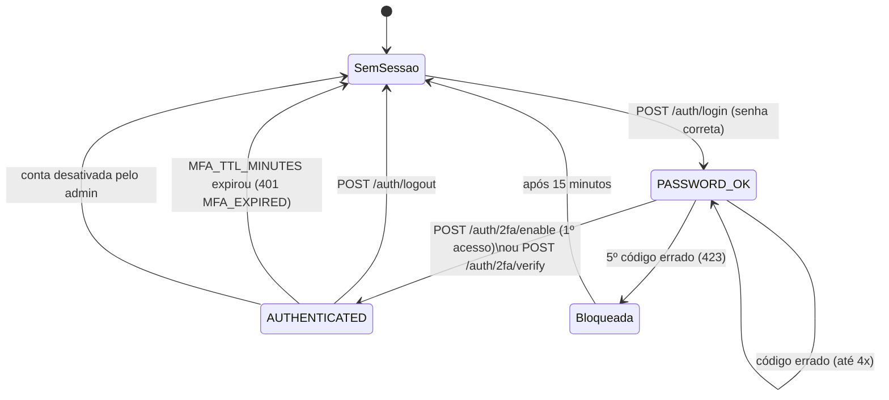
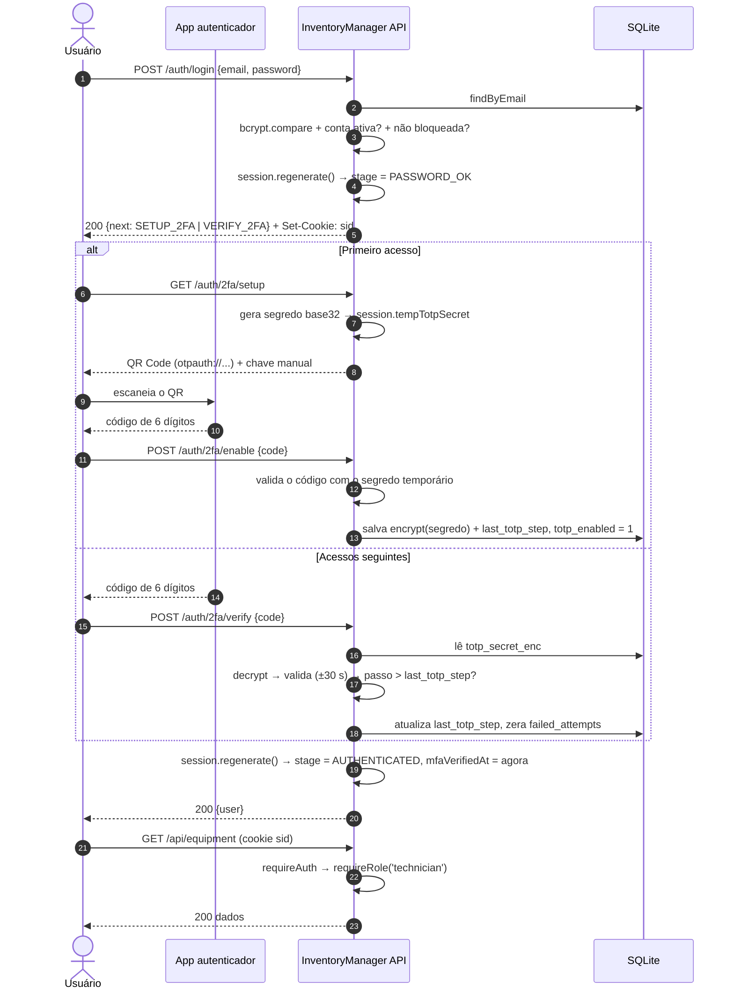
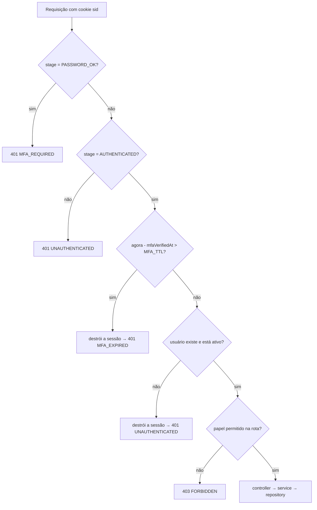
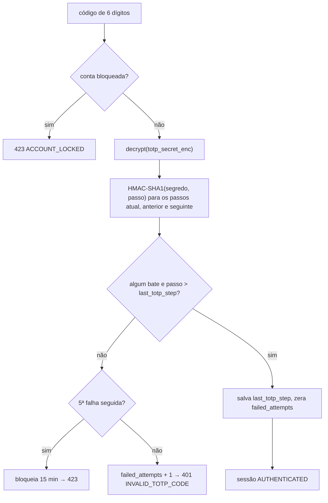

# Fluxo de Autenticação — 2FA com TOTP

Diagramas do fluxo de autenticação do InventoryManager (renderizados pelo GitHub via Mermaid).

## 1. Estágios da sessão

A sessão fica no servidor; o navegador só guarda um cookie `httpOnly` com o ID dela.

| Estágio | O que o usuário pode acessar |
|---|---|
| sem sessão | `/auth/login`, `/health`, arquivos do front |
| `PASSWORD_OK` | só `/auth/2fa/setup`, `/auth/2fa/enable`, `/auth/2fa/verify` |
| `AUTHENTICATED` | `/auth/me` e as rotas `/api/*` do seu papel |

## 2. Sequência completa

## 3. O que acontece em cada rota protegida

Código: [`requireAuth`](../src/middlewares/authMiddleware.js) e [`requireRole`](../src/middlewares/roleMiddleware.js).

## 4. Validação de um código TOTP

Código: [`totpService.verifyCode`](../src/services/totpService.js) e [`authService.verifyTotpLogin`](../src/services/authService.js).

## 5. Camadas de proteção

| Camada | Onde | Contra o quê |
|---|---|---|
| Rate limit por IP (10 req / 15 min no login, 10 / 5 min no 2FA) | `rateLimitMiddleware.js` | força bruta a partir de um IP |
| Bloqueio da conta (5 códigos errados → 15 min) | `authService.registerInvalidCode` | força bruta distribuída em vários IPs |
| Anti-replay (`last_totp_step`) | `totpService.verifyCode` | reuso de um código visto/interceptado |
| Segredo cifrado (AES-256-GCM) | `utils/crypto.js` | vazamento do banco |
| Senha com bcrypt | `utils/password.js` | vazamento do banco |
| `session.regenerate()` no login e no 2FA | `authService` | session fixation |
| Expiração do 2FA (`MFA_TTL_MINUTES`) | `requireAuth` | sessão/cookie roubado usado por muito tempo |
| Cookie `httpOnly`, `sameSite=lax`, `secure` em produção | `config/session.js` | roubo do cookie via XSS, CSRF |
| CSP + `textContent` no front | `app.js` (helmet), `public/js/api.js` | XSS |
